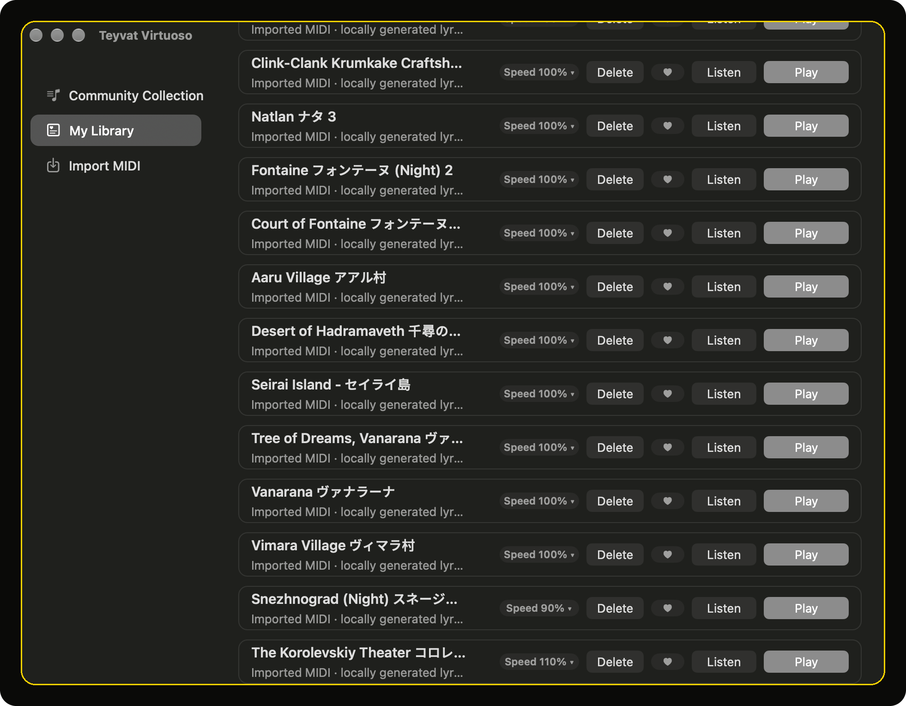
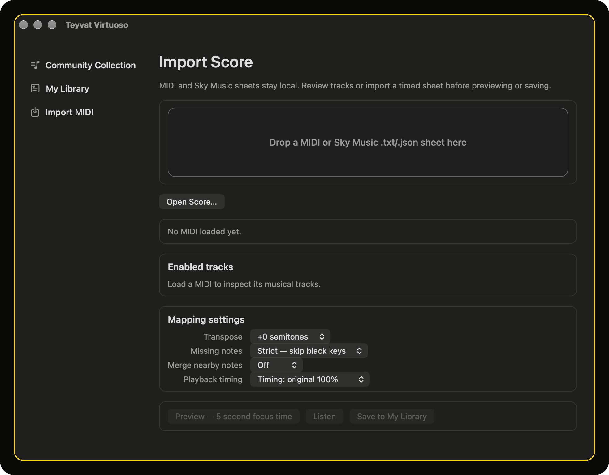

<p align="center">
  
</p>

<h1 align="center">Teyvat Virtuoso</h1>

<p align="center">Play MIDI files on the Genshin Impact lyre, natively on macOS.</p>

<p align="center">
  <a href="https://github.com/philippsyrov/Teyvat-Virtuoso/releases/latest"></a>
  
  <a href="LICENSE"></a>
</p>

<p align="center">
  <a href="https://github.com/philippsyrov/Teyvat-Virtuoso/releases/latest">Download</a> ·
  <a href="docs/README.md">Docs</a> ·
  <a href="https://github.com/philippsyrov/Teyvat-Virtuoso/issues">Issues</a>
</p>

Drop in a score, pick the tracks that matter, focus your game window, and let the app play the 21-key layout for you.

Everything runs locally: MIDI parsing, mapping, saved arrangements and keyboard playback stay on your machine. It is built for **NVIDIA GeForce NOW** on macOS and also works with other focused windows that accept normal Mac keyboard input.

<p align="center">
  
</p>

<table>
<tr><td><b>MIDI and Sky Music import</b></td><td>Drag-and-drop or open Standard MIDI plus Sky Music <code>.txt</code> / <code>.json</code> sheets from the app.</td></tr>
<tr><td><b>Track-aware reduction</b></td><td>Enable the melody and accompaniment you want, with note-range and chord-density hints.</td></tr>
<tr><td><b>Smart key mapping</b></td><td>Estimate major or minor context and map unavailable black keys deliberately, not at random.</td></tr>
<tr><td><b>Real chords and tempo</b></td><td>Up to three simultaneous key-down events, source tempo preserved, playback from 90% to 200%.</td></tr>
<tr><td><b>Focus, preview, stop</b></td><td>Five-second countdown before playback, card-level Stop, and offline tone previews.</td></tr>
<tr><td><b>Local library</b></td><td>Save generated performances, favourites, and per-song speed, plus a bundled public-domain demo.</td></tr>
</table>

## Install

Download the latest build from [GitHub Releases](https://github.com/philippsyrov/Teyvat-Virtuoso/releases/latest). **[v1.0.0](https://github.com/philippsyrov/Teyvat-Virtuoso/releases/tag/v1.0.0)** ships as a **macOS arm64** `.dmg`: open it and drag Teyvat Virtuoso into Applications.

<p align="center">
  
</p>

Grant **Accessibility** under **System Settings → Privacy & Security → Accessibility** when macOS asks. Keyboard playback depends on it.

## Build from source

```zsh
git clone https://github.com/philippsyrov/Teyvat-Virtuoso.git
cd Teyvat-Virtuoso
python3 -m unittest tests/test_play_score.py
./scripts/build_app.sh
open 'build/Teyvat Virtuoso.app'
```

The build script produces a self-contained app under `build/`. The running app does not need Python or third-party Swift packages.

## Docs

- [Instrument key mappings](docs/Genshin_Instrument_Key_Mappings.md): the 21-key lyre layout, with worked examples.
- [MIDI candidate preflight](docs/MIDI_Candidate_Preflight.md): whether a source will survive the 21-key reduction.
- [Private scores](docs/PRIVATE_SCORES.md): where private MIDI belongs and what the app saves locally.

## Private scores and copyright

Keep downloaded or purchased MIDI under the ignored `scores/private/` folder. Only redistribute sources or arrangements when you have permission. Generated score JSON lives in macOS Application Support, not in this repository.

## Disclaimer

Teyvat Virtuoso is an unofficial fan tool. It is not affiliated with or endorsed by HoYoverse. Automated input may be restricted by a game’s or platform’s terms; you decide where and how to use it.

## License

MIT, see [LICENSE](LICENSE).

Built by [Philipp Syrov](https://github.com/philippsyrov).

## Credits

Inspired by the workflow of [sabihoshi/GenshinLyreMidiPlayer](https://github.com/sabihoshi/GenshinLyreMidiPlayer) (MIT). Teyvat Virtuoso is an independent native macOS app with its own engine and UI.
