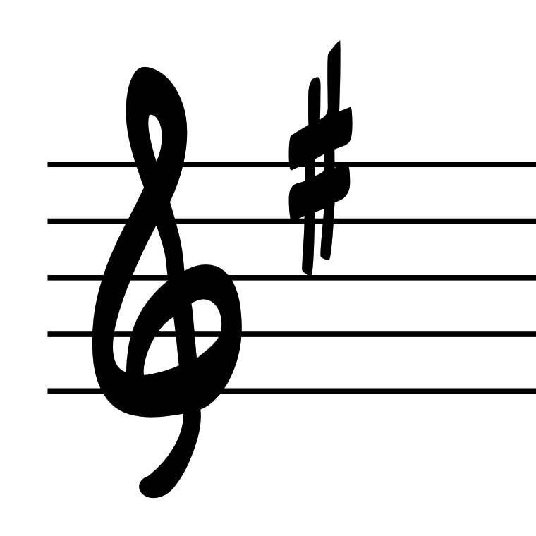

<p align="center">
  
</p>

# Teyvat Virtuoso

<p align="center">
  <a href="https://github.com/philippsyrov/Teyvat-Virtuoso/releases/latest">Download</a> |
  <a href="docs/README.md">Documentation</a> |
  <a href="https://github.com/philippsyrov/Teyvat-Virtuoso/issues">Issues</a>
</p>

<p align="center">
  <a href="https://www.apple.com/macos/"></a>
  <a href="player/"></a>
  <a href="LICENSE"></a>
  <a href="https://www.nvidia.com/en-us/geforce-now/"></a>
  <a href="https://github.com/philippsyrov/Teyvat-Virtuoso"></a>
  <a href="docs/README.md"></a>
  <a href="https://github.com/philippsyrov/Teyvat-Virtuoso/releases/tag/v1.0.0"></a>
</p>

**Turn Standard MIDI into live Genshin lyre performances on your Mac.** Drop in a score, pick the tracks that matter, focus your game window, and let the app play the 21-key layout for you.

Everything runs locally: MIDI parsing, mapping, saved arrangements, and keyboard playback stay on your machine. It is built for **NVIDIA GeForce NOW** on macOS and also works with other focused windows that accept normal Mac keyboard input.

<table>
<tr><td><b>MIDI and Sky Music import</b></td><td>Drag-and-drop or open Standard MIDI plus Sky Music `.txt` / `.json` sheets from the app.</td></tr>
<tr><td><b>Track-aware reduction</b></td><td>Enable the melody and accompaniment you want, with note-range and chord-density hints.</td></tr>
<tr><td><b>Smart key mapping</b></td><td>Estimate major or minor context and map unavailable black keys deliberately—not at random.</td></tr>
<tr><td><b>Real chords and tempo</b></td><td>Up to three simultaneous key-down events, source tempo preserved, playback from 90% to 200%.</td></tr>
<tr><td><b>Focus, preview, stop</b></td><td>Five-second countdown before playback, card-level Stop, and offline tone previews.</td></tr>
<tr><td><b>Local library</b></td><td>Save generated performances, favourites, and per-song speed—plus a bundled public-domain demo.</td></tr>
</table>

---

## Download

Browse [GitHub Releases](https://github.com/philippsyrov/Teyvat-Virtuoso/releases/latest). **v1.0.0** ships **source** on the tag—build locally on a Mac (see below). **[v0.2.1](https://github.com/philippsyrov/Teyvat-Virtuoso/releases/tag/v0.2.1)** includes a signed **macOS arm64** ZIP if you want a pre-built app from the pre-1.0 line.

Grant **Accessibility** under **System Settings → Privacy & Security → Accessibility** when macOS asks—keyboard playback depends on it.

## Build from source

```zsh
git clone https://github.com/philippsyrov/Teyvat-Virtuoso.git
cd Teyvat-Virtuoso
python3 -m unittest tests/test_play_score.py
./scripts/build_app.sh
open 'build/Teyvat Virtuoso.app'
```

The build script produces a self-contained app under `build/`. The running app does not need Python or third-party Swift packages.

<p align="center">
  
</p>

---

## Private scores and copyright

Keep downloaded or purchased MIDI under the ignored `scores/private/` folder. Only redistribute sources or arrangements when you have permission. Generated score JSON lives in macOS Application Support—not in this repository.

## Disclaimer

Teyvat Virtuoso is an unofficial fan tool. It is not affiliated with or endorsed by HoYoverse. Automated input may be restricted by a game’s or platform’s terms; you decide where and how to use it.

## License

MIT — see [LICENSE](LICENSE).

## Credits

Inspired by the workflow of [sabihoshi/GenshinLyreMidiPlayer](https://github.com/sabihoshi/GenshinLyreMidiPlayer) (MIT). Teyvat Virtuoso is an independent native macOS app with its own engine and UI.
